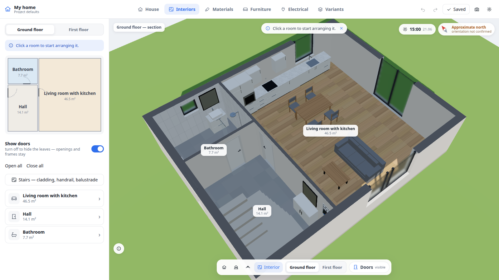

# Home Simulator

A 3D configurator engine for **your own home or apartment**. Give it the floor plan — a CAD drawing, an architect's PDF or a
plain plan image from an estate agent — and an AI coding agent builds a 1:1 model you can walk through, furnish, finish, plan
sockets and switches in, compare variants of, and carry on your Android phone, offline.

The engine knows no building. A building is a **project package** — `projects/<id>/project.json` — loaded at runtime.
Two synthetic examples ship with it: `demo-apartment` (a 52 m² flat) and `sample-house` (two storeys, stairs, plot, sun).



## Quick start

```bash
npm install
npm run dev              # http://localhost:5173/ — your own project if there is one, else sample-house;
                         # ?project=demo-apartment (or any id) opens another; port busy: npm run dev -- --port 5180
```

Requirements: Node.js ≥ 22.18. For importing plans: Python 3.11 + `tools/requirements.txt`; poppler for PDF sheets; the ODA File
Converter for DWG. For previews and the phone: Google Chrome / Chromium; an Android phone with Chrome.

## Make your home in five lines

1. Clone the repository and run `npm install`.
2. Open it with an AI coding agent — Claude Code, Codex, Cursor, Gemini CLI… (skills are in `skills/`; `AGENTS.md` tells agents
   where to look).
3. Say: *"Use the home-from-plan skill to build my flat from ./my-plan.png"* and answer its few questions (name, which file is
   which floor, one real dimension if the scale is unclear).
4. Look at the preview it shows you next to your drawing, correct what is wrong (*"the bathroom door opens the other way"*).
5. `npm run dev` → `http://localhost:5173/?project=<id>` — or *"put it on my phone"*.

## Skills

| Skill | What it does |
|---|---|
| [`home-from-plan`](skills/home-from-plan/SKILL.md) | builds or updates a project from DWG / DXF, PDF sheets, plan images or a description |
| [`home-check`](skills/home-check/SKILL.md) | validates, previews and runs a project; explains every error |
| [`home-to-phone`](skills/home-to-phone/SKILL.md) | installs and updates the app on an Android phone over USB (PWA, no store) |

Skills use the open Agent Skills format (`SKILL.md` + scripts + references). Everything they do is also a command you can run
yourself — see [docs/SKILLS.md](docs/SKILLS.md).

## What you can do in the app

- Walk through the building at eye level, up the stairs and out onto the plot; look at it from outside or cut through a level.
- Furnish rooms from a parametric catalog (dimensions 1:1), save several arrangements per room, import your own GLB furniture.
- Finish walls, floors and ceilings with materials at real scale (tiles, planks, herringbone, paint, wallpaper…).
- Hang TVs, mirrors and cabinets on walls with centimetre precision; plan sockets, switches, lights and smart-home devices, and
  export the electrical plan as PDF.
- Keep variants of the whole design and compare two side by side; undo / redo everything.
- Sunlight for any date and time when the project has a position (module `sun`).
- English and Polish UI; works offline as an installed app.

## Project package

`projects/<id>/source/plan.json` (written by people and agents) is compiled by `npm run project:build -- projects/<id>` into
`projects/<id>/project.json` (read by the engine). Spec: [docs/PROJECT_PACKAGE_SPEC.md](docs/PROJECT_PACKAGE_SPEC.md);
authoring guide: [docs/AUTHORING.md](docs/AUTHORING.md); schemas: `schemas/`.

Without an agent: copy `projects/demo-apartment/source/plan.json` to `projects/<id>/source/plan.json` (the directory name is
the project id), set `project.id` and `project.name`, and edit it — format and a commented example:
[skills/home-from-plan/references/plan-schema.md](skills/home-from-plan/references/plan-schema.md). Then:

```bash
npm run project:build -- projects/<id>       # plan.json → project.json (errors and warnings explained)
npm run project:validate -- projects/<id>    # the checks the app runs at load time
npm run project:preview -- projects/<id>     # projects/<id>/preview/plan-<level>.png + 3d.png (git-ignored)
```
Write down in `projects/<id>/README.md` where the facts come from and what you assumed — the skills do the same.

## Phone

```bash
node scripts/phone/phone.mjs doctor          # what is missing
node scripts/phone/phone.mjs serve           # build, serve on port 4170 over USB, open Chrome on the phone → "Install app"
```
Details: [docs/PHONE.md](docs/PHONE.md).

## How it is built

```
skills/ ──► tools/ (Python: CAD, PDF, image) ──► projects/<id>/source/plan.json ──► npm run project:build ──► projects/<id>/project.json
                                                                                                                │
src/ engine (React 19, three.js r181, react-three-fiber, Vite 7, TypeScript) ◄── projects/index.json ◄──────────┘
   project boundary (src/project) · model (src/home/model) · scene · UI · document & sync (src/document) · PWA (src/pwa)
packages/core: the pure core shared by the app, the CLI and tools — package contract and schema, plan.json compiler,
   building model, the shell as manifold solids (no DOM, three.js or React)
```
Glossary: [docs/GLOSSARY.md](docs/GLOSSARY.md).

## Limits

Generated walls need orthogonal plans; attic ceilings slope inside but there is no roof outside unless the project brings a GLB model; stairs are
two-flight U-turn only; iOS is not covered by the phone flow. Full list: [docs/KNOWN_LIMITATIONS.md](docs/KNOWN_LIMITATIONS.md).

## Contributing

`npm run typecheck && npm test && npm run test:e2e`, plus `npm run audit:genericity` (no building-specific code),
`npm run audit:i18n` and `npm run audit:core` (the core stays pure).
Code, comments and docs are English; UI strings go through `t()`.

## Licence

MIT — see [LICENSE](LICENSE).
